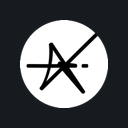
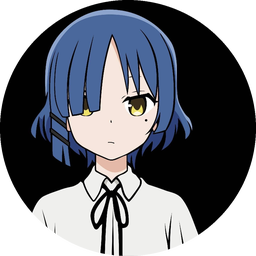
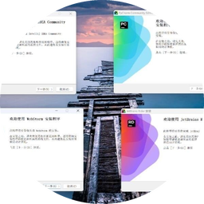
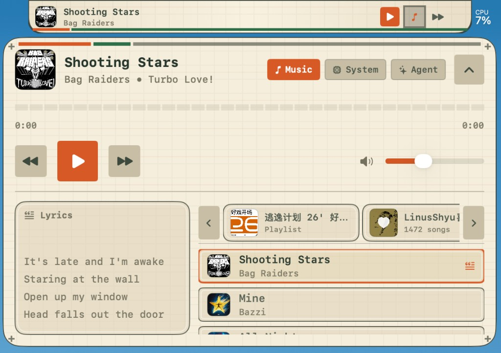
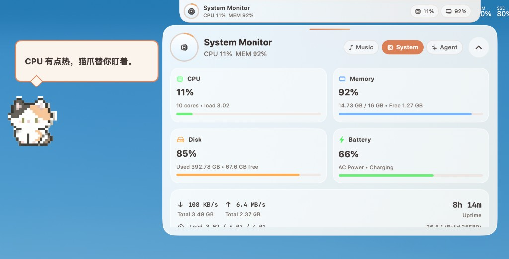
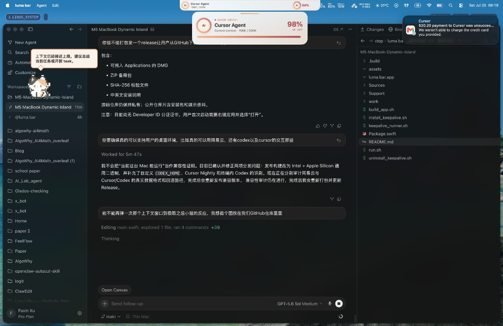
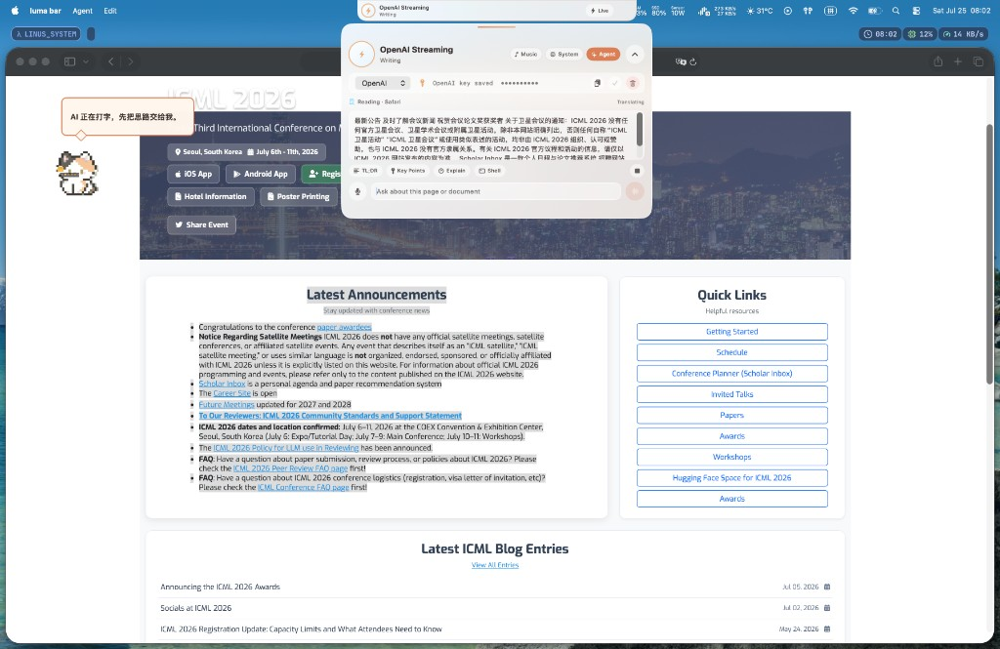

# Luma Bar [](https://github.com/Linus-Shyu/Luma-Bar/releases/latest)

Luma Bar is a native macOS workspace that grows around the camera notch on Macs. It uses the system safe areas beside the notch for music, a local AI agent, voice input, in-notch task alerts, system controls, and a desktop pet — without covering the camera.

> [!NOTE]
> 简体中文文档见 [README.md](README.md)。


## 🏆 Sponsors & Partners

Luma Bar would not be where it is without these partners — **our sincere thanks to each of them**:

<p align="center">
  <a href="https://x-combinator.xyz/" title="X-Combinator"></a>
  <a href="https://everlasting.zone/" title="Everlasting Zone"></a>
  <a href="https://www.adventure-x.cn/" title="AdventureX"></a>
  <a href="https://www.amazonaws.cn/en/" title="Amazon Web Services"></a>
  <a href="https://bonjour.bio/" title="Bonjour"></a>
</p>

| Partner | What they did for Luma Bar | Founder |
|---------|----------------------------|---------|
| **[X-Combinator](https://x-combinator.xyz/)** | Funded our Apple Developer Account, letting Luma Bar polish every detail for the App Store | Lloyd |
| **[Everlasting Zone](https://everlasting.zone/)** | Provided funding support that keeps Luma Bar iterating and growing | Shorpen |
| **[AdventureX](https://www.adventure-x.cn/)** | Where Luma Bar was born — from a sketch into a full product | — |
| **[Amazon Web Services](https://www.amazonaws.cn/en/)** | Awarded the track second prize and ¥10,000 — a wonderful vote of confidence | — |
| **[Bonjour](https://bonjour.bio/)** | Luma Bar's content community, home of its content and stories | Vincent |

### 💛 Individual Sponsors

<p align="center">
  
  <a href="https://github.com/Hongbro886" title="Hongbro886"></a>
  
</p>

<p align="center">Thanks to <b>Cai Ziqi</b>, <b>Hongbro886</b> and <b>Qianxun</b> for their support.</p>

### Core concepts

1. **Notch-native layout** — `auxiliaryTopLeftArea` / `auxiliaryTopRightArea`; camera stays clear
2. **Music & lyrics** — local audio and NetEase playlists with live artwork / progress / synced lyrics
3. **Local AI agent** — streaming replies, preferences, recent context, confirmed local actions
4. **Cursor / Codex awareness** — context-window usage and in-notch completion alerts
5. **Voice Whisper** — `⌘ ⇧ M` dictation into the Agent input
6. **macOS controls** — playback, volume, brightness, Wi-Fi, appearance, apps, lock, and more
7. **Desktop pet** — reacts to time, weather, and the frontmost app
8. **Fullscreen-friendly** — smooth hide / restore across Spaces and fullscreen

See [docs/OPEN_SOURCE.md](docs/OPEN_SOURCE.md) for what is open-sourced and what stays out of the repo.

## Table of Contents

- [Highlights](#highlights)
- [Get started](#get-started)
- [Run your first build](#run-your-first-build)
- [Screenshots](#screenshots)
- [Permissions & privacy](#permissions--privacy)
- [About this repository](#about-this-repository)
- [Acknowledgements](#acknowledgements)
- [Contributing](#contributing)
- [License](#license)

### Highlights

- **Permissive Apache 2.0 license:** Experiment, customize, and ship commercially (with the patent grant; trademarks are reserved in `NOTICE`).
- **Notch geometry, not a floating sticker:** Follows Apple’s safe areas; on notchless displays the island stays centered and shrinks symmetrically to avoid covering menu-bar icons.
- **Local-first:** API keys go to Keychain, never into Git; remote calls happen only when you invoke Agent features that need a model.
- **Themes:** Void / Grid / Arcade / Nook / Horizon / Forge / Aura (Aura has adjustable frost).
- **AdventureX 2026:** 2nd prize, Quick Quick Amazon Quick track.

## Get started

Requires **macOS 14+** and a Swift 6 toolchain. A Mac with a camera notch is recommended.

### Download (recommended)

Get a notarized DMG / ZIP from [Releases](https://github.com/Linus-Shyu/Luma-Bar/releases/latest).

### Build from source

```bash
git clone https://github.com/Linus-Shyu/Luma-Bar.git
cd Luma-Bar
./build_app.sh
open "luma bar.app"
```

Day-to-day development:

```bash
swift build
./run.sh
```

NetEase / `.ncm` needs NetEase Cloud Music installed. For remote models, prepare an OpenAI API key (or another provider you configure in the Agent panel).

## Run your first build

```bash
export OPENAI_API_KEY="..."
# optional:
export LUMA_BAR_OPENAI_MODEL="..."

./build_app.sh
open "luma bar.app"
```

You can also save the key from the Agent panel. On first launch, grant Accessibility, Microphone / Speech Recognition, Automation, and related permissions as needed. Completion alerts are drawn in the notch — **no Notification Center permission**.

## Screenshots

**Music**



**System & pet**



**Context nearly full**



**Agent workspace**



## Permissions & privacy

Grant only what you use: Accessibility, Microphone / Speech Recognition, Automation, Contacts; Full Disk Access only if Cursor / Codex data lives in a protected location.

Luma Bar is local-first: recent operational context expires; secrets stay out of the repo. See [SECURITY.md](SECURITY.md).

## About this repository

This repository contains the full application source, build scripts, and docs under the [Apache License 2.0](LICENSE). Attribution lives in [`NOTICE`](NOTICE).

Stack overview:

- **SwiftUI** — compact bar, expanded panels, themes
- **AppKit** — borderless `NSPanel` (island + pet)
- **MediaRemote / AVFoundation** — playback state and local audio
- **SQLite** — Cursor / Codex / NetEase metadata when available
- **Keychain** — provider credentials


## ⭐ Star History

<p align="center">
  <a href="https://www.star-history.com/#Linus-Shyu/Luma-Bar&type=date&legend=top-left">
    <picture>
      <source media="(prefers-color-scheme: dark)" srcset="https://api.star-history.com/svg?repos=Linus-Shyu/Luma-Bar&type=date&legend=top-left&theme=dark">
      
    </picture>
  </a>
</p>

## Acknowledgements

This project builds on:

- [Swift](https://www.swift.org/) / SwiftUI / AppKit
- Apple Music, NetEase Cloud Music, and other local players (via public or on-device interfaces; not affiliated)
- Cursor / Codex local session data (read-only probing; not affiliated)

We intend to keep Luma Bar open source so others can extend the approach.

## Contributing

Issues and PRs are welcome. Please read:

- [CONTRIBUTING.md](CONTRIBUTING.md)
- [CODE_OF_CONDUCT.md](CODE_OF_CONDUCT.md)
- [SECURITY.md](SECURITY.md)

Keep diffs focused. **Island chrome visuals are frozen** — do not restyle them by default. **Do not change** release / notarization pipelines under `.github/workflows/` unless maintainers ask.

## License

This project is licensed under the [Apache License 2.0](LICENSE).
